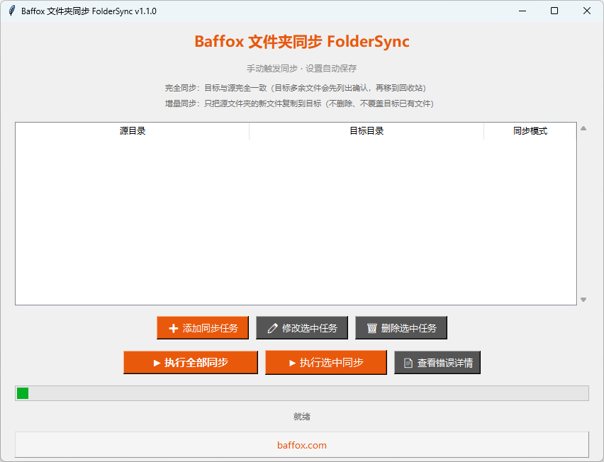

# Baffox 文件夹同步 FolderSync

一个简单、免费、开源的 Windows 文件夹同步小工具：添加几组「源文件夹 → 目标文件夹」，点一下就同步。适合把照片、作品、工作文件备份到移动硬盘、U 盘或 NAS。可以当作已停更的微软 SyncToy 的轻量替代。


<!-- TODO: 放一张软件截图到 docs/screenshot.png -->

## 功能

- **多组同步任务**：任意添加/修改/删除，设置自动保存
- **增量同步**：只把源里新增的文件复制到目标，不删除、不覆盖目标已有文件
- **完全同步**：让目标和源保持一致（复制新文件、更新改动过的文件、清理多余文件）
- **删除前预览**：完全同步要删除的文件会先全部列出，确认后才删；也可以选择「只复制，不删除」
- **删除进回收站**：被删文件放进 Windows 回收站，可以恢复；进不了回收站时移到目标目录下的 `.foldersync_trash` 文件夹，**绝不永久删除**
- **防误操作**：禁止把目标放在源里面，或源放在目标里面
- **错误详情**：同步出错可以在软件里查看，并保存到 `sync_errors.log`
- 设置文件 `sync_settings.json` 保存在 exe 同目录（不可写时保存到 `%APPDATA%\BaffoxFolderSync`）

## 下载

到 [Releases](../../releases) 页面下载最新的 `BaffoxFolderSync.exe`，双击即可运行，无需安装。

## ⚠️ 注意事项

- **完全同步会删除目标里多余的文件。** 第一次使用请仔细核对源目录和目标目录，别选反了；删除前的预览列表一定要看一眼。
- **杀毒软件可能误报。** exe 是用 PyInstaller 打包的，并且没有购买代码签名证书，Windows SmartScreen 或部分杀毒软件可能提示风险。源代码全部公开，介意的话可以按下面的步骤自己打包。

## 从源码运行 / 自己打包

需要 Windows + Python 3.8 以上。

```bat
git clone <本仓库地址>
cd baffox-folder-sync
pip install -r requirements.txt
python file_sync.py
```

打包成 exe：双击 `build.bat`，或者执行

```bat
pip install -r requirements.txt
pyinstaller --noconfirm --clean file_sync.spec
```

生成的程序在 `dist\BaffoxFolderSync.exe`。想要自定义图标，把 `sync.ico` 放到仓库根目录再打包即可。

运行测试：

```bat
python -m unittest discover tests
```

## English summary

**Baffox FolderSync** is a tiny, free, open-source folder sync tool for Windows (Python + tkinter). Define source → target pairs and sync them with one click.

- **Incremental mode** copies only new files; nothing in the target is overwritten or deleted.
- **Full mode** mirrors the source into the target. Files to be deleted are listed for confirmation first, then sent to the Recycle Bin (fallback: moved to `.foldersync_trash` in the target — never permanently deleted).
- Nested source/target paths are blocked; errors are viewable in-app and logged to `sync_errors.log`.
- Download the exe from [Releases](../../releases), or build it yourself with `build.bat` (PyInstaller).
- ⚠️ The exe is unsigned, so antivirus / SmartScreen may show false positives. Double-check paths before using full sync.

## License

[MIT](LICENSE) © 2026 Liu Jian / Baffox · [baffox.com](https://baffox.com)
